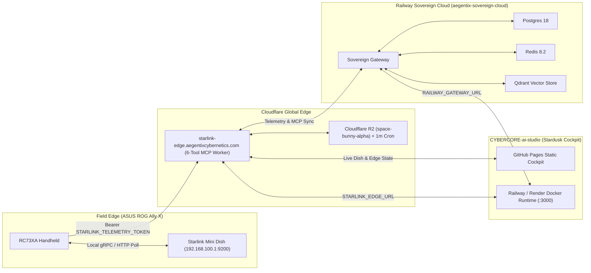

# Aegentix Cybernetics — Sovereign Cloud & Off-Device Production Runbook

**Platform:** `CYBERCORE-ai-studio` (Stardusk Sovereign Cockpit & Multi-Domain OS)  
**Architecture:** Zero-Install Browser Static Edge + Cloudflare 6-Tool MCP + Railway/Render Hardened Containers  
**Runtime Compliance:** Node.js 22 Alpine (Non-Root NIST SP 800-190) · Zero-Fake-Balance Gate Enforced

---

## 1. Live Off-Device Sovereign Architecture



---

## 2. Zero-Install Browser Access (GitHub Pages)

Every push to `main` builds and publishes the static Stardusk Sovereign Cockpit via `.github/workflows/deploy-github-pages.yml` (`npx vite build --base=/CYBERCORE-ai-studio/`). No local install or workstation daemon is required to inspect live edge telemetry:

| Cockpit Surface | Live GitHub Pages Route | Purpose |
| :--- | :--- | :--- |
| **Primary Sovereign App** | `https://shalominattii-us.github.io/CYBERCORE-ai-studio/` | Main React 19 Sovereign OS Suite & Stardusk Command |
| **Stardusk Standalone Deck** | `https://shalominattii-us.github.io/CYBERCORE-ai-studio/stardusk.html` | Lightweight zero-bundle Stardusk telemetry & Dish HUD |
| **Aegentix Tactical Cockpit** | `https://shalominattii-us.github.io/CYBERCORE-ai-studio/aegentix-cockpit/index.html` | Autonomous swarm & multi-agent tactical control room |
| **Studio Production Console** | `https://shalominattii-us.github.io/CYBERCORE-ai-studio/studio.html` | Sovereign audio/media & broadcast engineering surface |

---

## 3. Off-Device Backend Deployment (Railway, Render & Cloudflare)

The repository ships declarative container manifests targeting the multi-stage hardened `Dockerfile` (`CMD ["node", "dist/server.js"]`, `EXPOSE 3000 7777`, `/health` probe).

### A. Railway (`railway.json`)

`railway.json` configures the `DOCKERFILE` builder with `/health` readiness checks (`healthcheckTimeout: 30`) and `ON_FAILURE` auto-recovery (`restartPolicyMaxRetries: 5`).

```bash
# Link to the existing aegentix-sovereign-cloud project and deploy off-device
railway link
railway up --detach
```

### B. Render Blueprint (`render.yaml`)

`render.yaml` provisions the `aegentix-cybercore-studio` Docker web service pre-wired with:
- `NODE_ENV=production`
- `STARLINK_EDGE_URL=https://starlink-edge.aegentixcybernetics.com`
- `RAILWAY_GATEWAY_URL=https://aegentix-sovereign-gateway-production.up.railway.app`

To deploy via Render Blueprints:
1. Open the Render Dashboard → **New +** → **Blueprint**.
2. Connect `shalominattii-us/CYBERCORE-ai-studio` (`main` branch); Render automatically detects `render.yaml` and deploys on every commit.

### C. Cloudflare 6-Tool MCP Worker Secrets

`.github/workflows/deploy-cloudflare-worker.yml` deploys `cloudflare-worker/` via Wrangler when repository secrets are configured. Never hardcode tokens in `wrangler.toml` or commit `.env` files.

Configure GitHub Actions repository secrets:
- `CLOUDFLARE_API_TOKEN` — Scoped Cloudflare Workers + R2 deploy token
- `CLOUDFLARE_ACCOUNT_ID` — Target Cloudflare Account ID

Bind the runtime telemetry ingestion secret directly to the Worker via Wrangler stdin/prompt (token-safe, never echoed in shell history):

```bash
cd cloudflare-worker
npx wrangler secret put STARLINK_TELEMETRY_TOKEN
```

---

## 4. ROG `RC73XA` Starlink Mini Dish Bridge (Token-Safe Operation)

When operating on the physical **ASUS ROG Ally X (`RC73XA`)** connected to the **Starlink Mini (`192.168.100.1:9200`)**, forward real-time dish metrics to `https://starlink-edge.aegentixcybernetics.com` using environment-scoped credentials only.

> [!IMPORTANT]
> Never pass `STARLINK_TELEMETRY_TOKEN` inline as a plaintext CLI flag in shared terminals, transcripts, or chat logs. Read it from an interactive masked prompt or user-scoped environment variable.

### PowerShell Forwarder (`public/rog-starlink-forwarder.ps1`)

```powershell
# Prompt securely in memory without echoing token to console or logs
$sec = Read-Host "Enter STARLINK_TELEMETRY_TOKEN" -AsSecureString
$env:STARLINK_TELEMETRY_TOKEN = [Runtime.InteropServices.Marshal]::PtrToStringAuto(
  [Runtime.InteropServices.Marshal]::SecureStringToBSTR($sec)
)
$env:STARLINK_EDGE_URL = "https://starlink-edge.aegentixcybernetics.com"

# Single telemetry snapshot verification (-Once)
pwsh -NoProfile -ExecutionPolicy Bypass -File .\public\rog-starlink-forwarder.ps1 -Once

# Continuous streaming bridge from 192.168.100.1:9200 (-Watch)
pwsh -NoProfile -ExecutionPolicy Bypass -File .\public\rog-starlink-forwarder.ps1 -Watch
```

### Cross-Platform Node.js Forwarder (`scripts/rog-starlink-forwarder.mjs`)

```bash
# Read token silently into session environment (POSIX / Git Bash / WSL2)
read -rsp "STARLINK_TELEMETRY_TOKEN: " STARLINK_TELEMETRY_TOKEN && echo
export STARLINK_TELEMETRY_TOKEN
export STARLINK_EDGE_URL="https://starlink-edge.aegentixcybernetics.com"

# Single dish probe & edge push (-Once)
node scripts/rog-starlink-forwarder.mjs -Once

# Continuous background dish telemetry forwarder (-Watch)
node scripts/rog-starlink-forwarder.mjs -Watch
```

---

## 5. Verification & CI Gates

Before promoting any release or merging into `main`, run the three deterministic verification gates locally (mirrored in `.github/workflows/production-smoke-and-zero-fake-gate.yml`):

```bash
# 1. Zero-Fake-Balance Audit Gate
# Scans src/ and public/ for banned legacy mock balances and writes SHA-256 manifest proof to:
# artifacts/verification/zero-fake-balance-audit.json
node scripts/verify-zero-fake-balance.mjs

# 2. Strict TypeScript Compiler Gate (tsc --noEmit)
npm run lint

# 3. Full Production Bundle (Vite Client + esbuild Server -> dist/server.js)
npm run build
```

### Container Smoke Test (Optional Local Parity Check)

```bash
docker build -t aegentix-cybercore-studio:prod .
docker run --rm -p 3000:3000 -e NODE_ENV=production aegentix-cybercore-studio:prod
# Probe readiness in a second terminal:
curl -fsS http://127.0.0.1:3000/health
```
